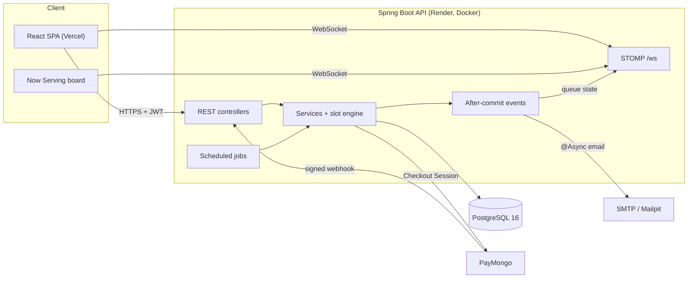

# QueueUp

[](https://github.com/unknowndevice077/queueup/actions/workflows/ci.yml)
[](https://github.com/unknowndevice077/queueup/actions/workflows/ci.yml)


**Multi-tenant booking and walk-in queue management for Philippine small businesses.**

Clinics, barbershops, salons and repair shops in the Philippines still run on Facebook messages, paper logbooks and a crowded *pila* (queue) at the door. Customers wait without knowing when they'll be called, owners lose money to no-shows, and two people get promised the same 3 PM slot. QueueUp gives each business a booking page customers use from their phones, a walk-in queue with live ticket numbers and a "Now Serving" TV board, optional GCash/Maya/card deposits through PayMongo to cut no-shows, automatic email confirmations and reminders, and a dashboard with the numbers that matter. One deployment serves many businesses, each isolated from the others.

> **Portfolio focus:** this project is built to show production-grade backend engineering: database-enforced double-booking prevention, tested tenant isolation, refresh-token rotation with theft detection, idempotent webhooks, and about 100 backend tests (unit and Testcontainers) behind a coverage gate.

## Live demo

**Demo:** _https://queueup.vercel.app (placeholder, see [deployment](docs/DEPLOYMENT.md))_ · **API docs:** _https://queueup-api.onrender.com/swagger-ui_

| Role | Email | Password |
|---|---|---|
| Owner (both demo businesses) | `owner@demo.queueup` | `Demo12345!` |
| Staff (Kanto Cuts) | `staff@demo.queueup` | `Demo12345!` |
| Customer | `customer@demo.queueup` | `Demo12345!` |

Demo businesses: **Kanto Cuts Barbershop** (`/b/kanto-cuts`, no deposit, 3 barbers with lunch breaks) and **Sanare Dental Clinic** (`/b/sanare-dental`, 20% deposit). Both come with 60 days of booking history.

## Screenshots

| | |
|---|---|
|  |  |
|  |  |

## Features

**Customers**
- Book in five taps: service → date → barber or "any available" → time → confirm, mobile-first
- Times always shown in the business's time zone; prices in ₱
- Pay a deposit through PayMongo (GCash, Maya, cards) when the business requires one
- Cancel or reschedule until the business's cancellation window closes
- Join a walk-in queue without an account and watch your position update live
- Confirmation, cancellation and 24-hour reminder emails

**Businesses**
- Dashboard: today's bookings, queue length, revenue, no-show rate, bookings per day, busiest hours, top services, CSV export
- Calendar (day and week, per staff member) with complete / no-show / cancel
- Queue console: call next, serve, done, skip, all live
- Full-screen "Now Serving" board for a TV, updated over WebSocket
- Services, staff (invite, roles, services they perform), weekly schedules with lunch breaks, blackouts, settings, audit log
- Roles: OWNER and STAFF per business; one person can belong to several businesses

**Engineering**
- Slot engine handling lunch breaks, buffers, blackouts, lead time and DST
- Double booking impossible even under concurrency (PostgreSQL exclusion constraint)
- Shared-schema multi-tenancy with a Hibernate filter and tests for every tenant-scoped endpoint
- JWT access tokens plus rotating, revocable refresh tokens with reuse detection
- Signed, idempotent PayMongo webhooks; pending deposits expire after 15 minutes
- RFC 7807 errors with trace ids, structured JSON logs, rate-limited login

## Architecture



More detail, sequence diagrams and the ERD: [docs/ARCHITECTURE.md](docs/ARCHITECTURE.md). Endpoint table: [docs/API.md](docs/API.md). Every design decision: [docs/DECISIONS.md](docs/DECISIONS.md).

## Tech stack

| Layer | Choice | Why |
|---|---|---|
| Language | Java 21 | Records, pattern matching and virtual-thread readiness on an LTS |
| Framework | Spring Boot 3.5 (Web, Data JPA, Security, Validation, WebSocket, Mail, Scheduling) | One cohesive, well-understood stack for every concern here |
| Database | PostgreSQL 16 + Flyway | Exclusion constraints, `timestamptz`, `jsonb`, partial indexes; migrations are reviewable SQL |
| Auth | JJWT (HS256) + opaque refresh tokens | Short stateless access tokens; refresh tokens stay revocable |
| Mapping | MapStruct | Compile-time DTO mapping, so entities never leak out of the service layer |
| Rate limiting | Bucket4j | Token buckets without extra infrastructure |
| Docs | springdoc-openapi | Swagger UI generated from the code, with RFC 7807 error schemas |
| Tests | JUnit 5, Mockito, AssertJ, Testcontainers, JaCoCo | Integration tests against real PostgreSQL, with a coverage gate in the build |
| Frontend | React 18, TypeScript, Vite | Fast builds, strict types |
| Data fetching | TanStack Query | Caching, retries and invalidation without hand-written state |
| Forms | React Hook Form + Zod | Same validation rules as the API, accessible error messages |
| Styling | Tailwind CSS | Responsive, mobile-first UI without a component library |
| Realtime | @stomp/stompjs | Matches Spring's STOMP broker; auto-reconnect |
| Charts | Recharts | Declarative charts, lazy-loaded only on the dashboard |
| Infra | Docker Compose, GitHub Actions, Render, Vercel | One-command local stack, CI on every push, free-tier hosting |

## Run it locally

Requirements: Docker Desktop. Ports 5173, 8080, 5432, 8025 and 1025 must be free (override with `FRONTEND_PORT`, `BACKEND_PORT`, `POSTGRES_PORT`).

```bash
git clone https://github.com/unknowndevice077/queueup.git
```

```bash
cd queueup
```

```bash
docker compose up --build
```

Then open:

- App: http://localhost:5173 (demo data is seeded on first start)
- API docs: http://localhost:5173/swagger-ui
- Emails (Mailpit): http://localhost:8025
- TV board: http://localhost:5173/b/kanto-cuts/display

No `.env` is needed for local use; every variable has a local default. Copy `.env.example` to `.env` to change anything.

### Without Docker for the app (hot reload)

```bash
docker compose up -d postgres mailpit
```

```bash
cd backend && SEED_DEMO=true ./mvnw spring-boot:run
```

```bash
cd frontend && npm install && npm run dev
```

The Vite dev server proxies `/api` and `/ws` to `localhost:8080`.

## Tests

Backend (needs Docker for Testcontainers): checkstyle, about 100 unit and integration tests, and the JaCoCo gate (service-layer line coverage of at least 70%; currently about 96%).

```bash
cd backend && ./mvnw verify
```

The HTML coverage report is written to `backend/target/site/jacoco/index.html`.

Frontend: ESLint, TypeScript, 20 Vitest + Testing Library tests, production build.

```bash
cd frontend && npm run lint && npm run typecheck && npm test && npm run build
```

Highlights:

| Test | Proves |
|---|---|
| `SlotEngineTest` (17 cases) | Lunch breaks, buffers, blackouts, lead time, past dates, no hours, quarter-hour alignment, DST gaps |
| `BookingConcurrencyIT` | 10 parallel requests for one slot: exactly 1 × 201 and 9 × 409 |
| `TenantIsolationIT` | Tenant A's owner gets 404 on 37 endpoint/resource combinations of tenant B, and B's data is untouched |
| `RoleAuthorizationIT` | STAFF cannot change settings (403); customers cannot see the calendar or others' bookings (404) |
| `AuthFlowIT`, `RefreshTokenServiceTest` | Register/login/refresh/logout, rotation, reuse detection revoking the family, RFC 7807 format |
| `PaymentWebhookIT` | Same event twice is processed once; forged or missing signature rejected |
| `BookingLifecycleIT` | Cancellation window, no-show rules, reschedule, 15-minute expiry job, constant query count on the list (no N+1) |
| `NotificationIT` | Email after commit; reminders sent once however often the job runs; failures retried |
| `api.test.ts` | Refresh on 401, one shared refresh for concurrent requests, queued requests, sign-out on rejection |
| `BookingFlow.test.tsx` | Full wizard, sign-in redirect keeping choices, 409 sends the user back to the time picker |

## Key engineering decisions

- **Multi-tenancy.** Shared schema with `tenant_id` on every tenant-owned row. The tenant comes from the URL (`/api/t/{slug}`); a filter binds a `TenantContext` with the caller's role there. Three layers: explicit tenant-scoped queries, a Hibernate `@Filter` enabled before every repository call, and service-level role checks. Non-members get **404**, never 403, so they can't probe what exists. ([ADR-001–003](docs/DECISIONS.md))
- **Double-booking prevention.** The server re-runs the slot engine for every request, never trusting the client. PostgreSQL then enforces `EXCLUDE USING gist (staff WITH =, tstzrange(starts_at, ends_at) WITH &&)` for active bookings, and both the exclusion violation and the race-induced deadlock become `409 Slot no longer available`. `@Version` optimistic locking guards concurrent status changes. ([ADR-005](docs/DECISIONS.md))
- **Refresh-token rotation.** Opaque 256-bit tokens stored only as SHA-256 hashes, rotated on every use within a token family. Replaying a used token revokes the whole family and forces sign-in. Roles are never in the JWT, so removing a staff member takes effect immediately. ([ADR-008, ADR-009](docs/DECISIONS.md))
- **Webhook idempotency.** HMAC-SHA256 signature check with replay window, then `INSERT ... ON CONFLICT (event_id) DO NOTHING` in the same transaction as the state change: duplicates are no-ops, and a failed attempt leaves nothing behind, so the retry succeeds. ([ADR-011](docs/DECISIONS.md))
- **Money as centavos.** Every amount is a `BIGINT` number of centavos; deposits use `BigDecimal` with half-up rounding. No floating point anywhere money is stored or computed. ([ADR-012](docs/DECISIONS.md))
- **UTC storage.** All instants are `timestamptz` in UTC, converted to the business's zone only at the edges: API responses carry `+08:00`, and analytics group by `AT TIME ZONE` so "per day" means the business's day. ([ADR-012](docs/DECISIONS.md))

## Project structure

```
queueup/
├── backend/                     Spring Boot API
│   ├── src/main/java/com/queueup/
│   │   ├── config/              security, CORS, WebSocket, OpenAPI, async, scheduling
│   │   ├── common/              base entities, tenant context, errors, trace id, pagination
│   │   ├── auth/  tenant/  user/  catalog/  schedule/
│   │   ├── booking/             slot engine, availability, lifecycle, expiry job
│   │   ├── queue/  payment/  notification/  analytics/  audit/  seed/
│   ├── src/main/resources/
│   │   ├── db/migration/        Flyway V1–V5
│   │   └── templates/email/     Thymeleaf emails
│   └── src/test/java/           unit tests + Testcontainers ITs
├── frontend/                    React + Vite SPA
│   └── src/
│       ├── lib/                 API client, formatting, live queue hook
│       ├── auth/                auth context, route guards
│       ├── components/          UI kit, calendar, slot picker, toasts
│       └── pages/               public, business, my, dashboard
├── docs/                        ARCHITECTURE, API, DECISIONS, DEPLOYMENT, screenshots
├── .github/workflows/ci.yml
├── docker-compose.yml
└── render.yaml
```

## Roadmap

- **SMS notifications** through a Philippine gateway (Semaphore) behind the existing `NotificationSender` interface
- **Google Calendar sync** for staff, two-way with conflict detection
- **Multi-branch businesses**: one owner, several locations, cross-branch reporting
- Email verification and password reset
- Per-tenant branding and custom domains
- Waitlist that auto-offers freed slots
- Redis-backed rate limiting and STOMP broker relay for horizontal scaling

## License

MIT
