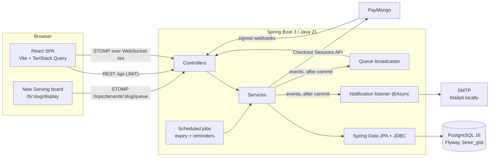
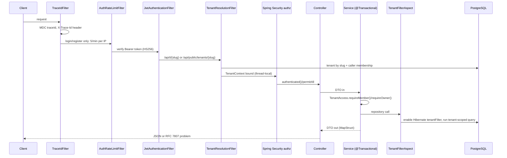
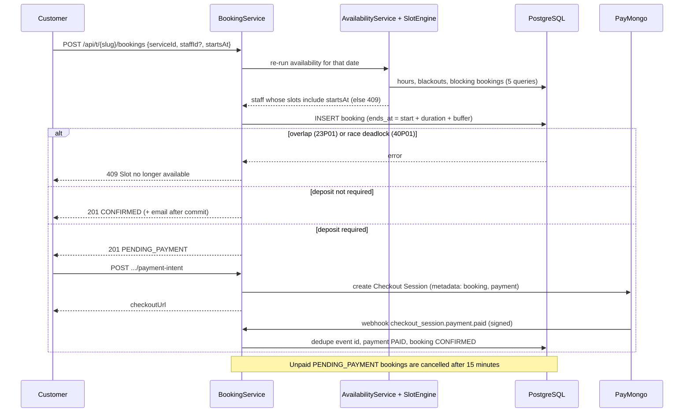
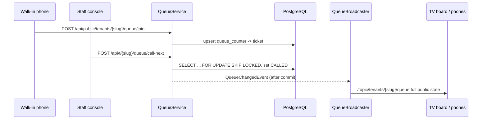
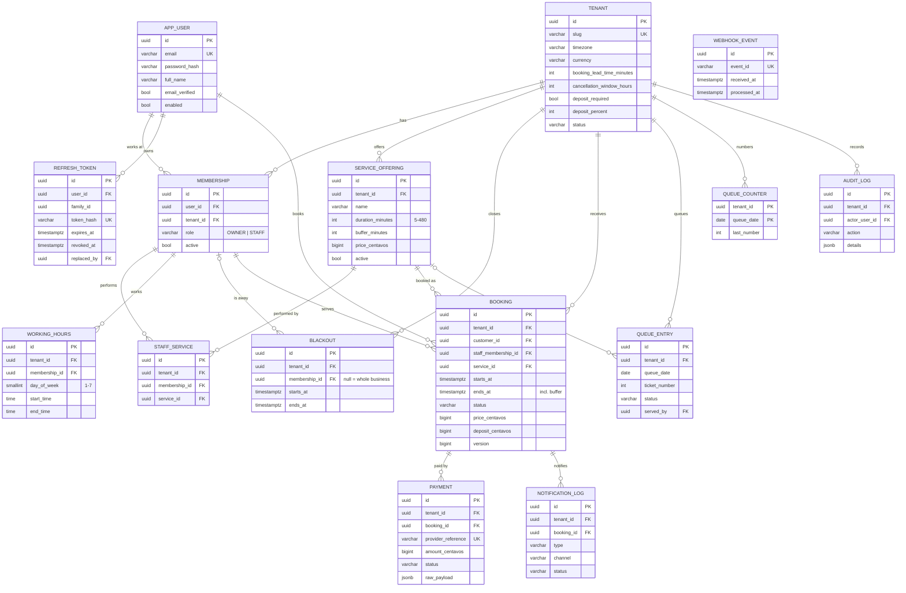

# Architecture

QueueUp is a modular monolith: one Spring Boot service with feature packages, one PostgreSQL database, and a React single-page app. This page explains how a request flows, how tenants are kept apart, and what the data looks like.

## System context

## Request pipeline

- **No business logic in controllers.** Controllers map HTTP to service calls, nothing else.
- **DTOs only.** Entities never leave the service layer; MapStruct (`BookingMapper`, `ServiceMapper`, `TenantMapper`, `UserMapper`) or small records do the mapping.
- **Transactions.** Writes use `@Transactional`, reads use `readOnly = true`. Open-session-in-view is off.
- **Errors.** `GlobalExceptionHandler` maps everything to `ApiError` (RFC 7807 plus `errors[]` and `traceId`). Filters and security entry points use the same writer.

## Packages

| Package | Responsibility |
|---|---|
| `config` | Security, CORS, WebSocket, OpenAPI, async executor, scheduling switch, typed `AppProperties`, `DATABASE_URL` normaliser |
| `common` | Base entities, tenant filter definition, `TenantContext`/`TenantAccess`, exceptions, problem responses, trace id, pagination, validation |
| `auth` | Register/login/refresh/logout, JWT, refresh-token rotation, rate limiting |
| `tenant` | Businesses, public profile, settings, tenant resolution filter |
| `user` | Users, memberships, staff management, `/api/me` |
| `catalog` | Services and staff-to-service links |
| `schedule` | Weekly working hours and blackouts |
| `booking` | Slot engine, availability, booking lifecycle, expiry job |
| `queue` | Walk-in queue, ticket counter, STOMP broadcaster |
| `payment` | PayMongo checkout, webhook verification and idempotency |
| `notification` | Sender abstraction, email templates, reminder job, notification log |
| `analytics` | Dashboard aggregates and CSV export (SQL in the tenant time zone) |
| `audit` | Append-only audit log |
| `seed` | Demo data (only when `SEED_DEMO=true`) |

## Booking: from slot to confirmation

### Slot engine

For one staff member on one tenant-local date:

1. Convert the weekday's working ranges (several per day model lunch breaks) to UTC intervals with `ZonedDateTime`.
2. Subtract busy intervals: business-wide and staff blackouts, and `PENDING_PAYMENT`/`CONFIRMED` bookings (whose `ends_at` already includes their buffer).
3. Walk the local clock in 15-minute steps; keep a start when `[start, start + duration + buffer]` lies inside a free interval.
4. Drop starts before `now + booking_lead_time_minutes` (so past dates yield nothing).
5. Return `ZonedDateTime`s, serialised as ISO-8601 with offset (`2026-10-06T10:00:00+08:00`).

## Live queue

## Entity relationship diagram

All tables also carry `created_at` and `updated_at`. Every foreign key is indexed, plus `booking (tenant_id, starts_at)` and `booking (staff_membership_id, starts_at)`.

Key constraints:

- `booking_no_staff_overlap`: `EXCLUDE USING gist (staff_membership_id WITH =, tstzrange(starts_at, ends_at) WITH &&) WHERE (status IN ('PENDING_PAYMENT','CONFIRMED'))`
- `notification_log_sent_uk`: unique `(booking_id, type, channel) WHERE status = 'SENT'`
- `queue_entry_ticket_uk`: unique `(tenant_id, queue_date, ticket_number)`
- `webhook_event_event_uk`: unique `(event_id)`

## Observability

- `X-Trace-Id` on every response, also in every error body and in the log MDC (propagated into async notification threads).
- `prod` profile logs JSON (Logstash encoder) with `traceId`, `tenant` and `userId` fields; other profiles log readable lines.
- `/actuator/health` is public (with DB check, no details); every other actuator endpoint is denied.
- Passwords, tokens and webhook payloads are never logged; request DTOs override `toString()` to redact secrets.
